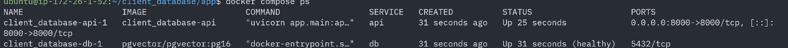
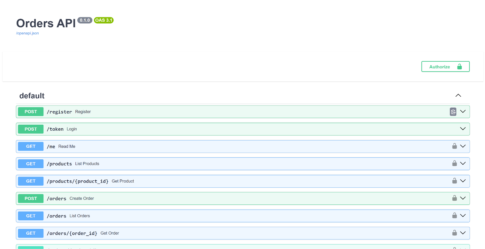

# Deploy the server

1. Connect to the server using public key
```shell
ssh ubuntu@52.78.131.98
```
Note: already added authorized key from .ssh/id_rsa.pub with 'echo "<public_key>">> authorized_keys', so no -i flag needed

Also added config and put Host as orders-api

2. Install Needed packages

Update the Linux system
```shell
sudo apt update
sudo apt upgrade -y
```

Curl and install Docker from the original source
```shell
curl -fsSL https://get.docker.com -o get-docker.sh

sudo sh get-docker.sh
```
Note: added ubuntu into docker group to use docker commands without sudo
```shell
sudo usermod -aG docker ubuntu
```

Install git and htop for management
```shell
sudo apt install -y git
sudo apt install -y htop
```

3. Clone the git repository
```shell
git clone https://github.com/nukten163/client_database
```
Note: also add variable to .env according to .env.example

4. Add firewall rule
Add a rule to let any ipV4 to access :8000 port

5. Compose docker container
```shell
docker compose up -d --build
```
Note: -d to detatch(run in the background) --build for the image

6. Redployed
When changes occured, run this to redeploy:
```shell
docker compose down
git pull
docker compose up -d --build
```

## The address: 
http://52.78.131.98:8000/docs

## The screenshots:
compose up


compose ps


swagger

